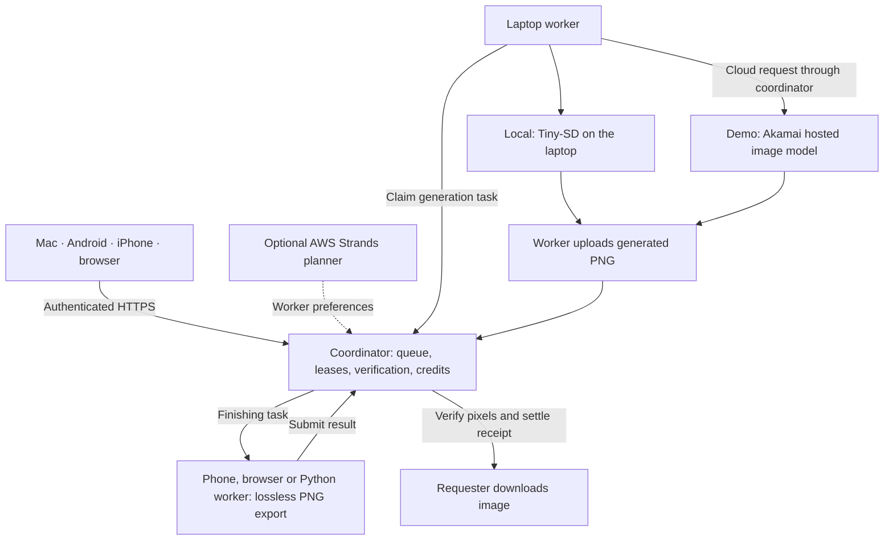

<p align="center">
  <picture>
    <source media="(prefers-color-scheme: dark)" srcset="brand/gipu-wordmark-on-dark.svg">
    <source media="(prefers-color-scheme: light)" srcset="brand/gipu-wordmark.svg">
    
  </picture>
</p>

<p align="center"><strong>Create an image. Share the work. Keep control.</strong></p>
<p align="center">
  <a href="https://github.com/GiPU-Hackmidwest/gipu/releases">Download</a> ·
  <a href="#try-gipu">Try GiPU</a> ·
  <a href="#how-it-works">How it works</a> ·
  <a href="#build-from-source">Build from source</a>
</p>

GiPU connects laptops, phones and browsers into a shared image-making workflow. Ask for an image, let available devices handle each stage, and download the verified result. Contributors choose when to help and earn sandbox credits for accepted work.

The hosted demo uses **Akamai image inference**; laptops manage generation tasks and phones finish the images. **Local generation with Tiny-SD** is also supported. The app labels cloud-generated images so you can tell which path ran.

> The product is GiPU. The repository, bundle identifiers and `POCKETGRID_*` settings keep their original PocketGrid names.

## Try GiPU

1. **Join a grid.** Use **Sign in another way** with the grid address and join code, or scan a grid invite if your host provides one. A new account starts with 100 sandbox credits.
2. **Link your devices.** Show your account's **Link QR** on a signed-in device and scan it on your phone to share the same account and balance. Give friends the grid address and join code to create their own accounts; keep your Link QR for your own devices.
3. **Choose when to help.** In **Contribute**, turn on **Create images** on a Mac or **Finish images** on a phone or browser. Sharing starts only when you choose it; turn the switch off to pause.
4. **Create and follow.** Enter a prompt in **Create**. See work queue until compatible devices are available, then move through generation and finishing. Download the verified PNG and check the receipt.

**Activity** keeps your request and credit history together. **Leaderboard** offers an optional public nickname and weekly participation rankings; it resets Monday at 00:00 UTC. Your account stays private unless you join it.

Phones must be able to reach the grid and keep the app open while finishing work. A local grid can run over your LAN; hosted grids and cloud inference need internet access. A USB cable is only needed for installation/debugging where your install method requires it. Windows users can use the browser; there is no published Windows installer yet.

## Download

Get the published **Apple-silicon Mac DMG** and **Android APK** from [GitHub Releases](https://github.com/GiPU-Hackmidwest/gipu/releases). These are prototype installs, outside the app stores:

| Device | Run GiPU |
| --- | --- |
| Mac (Apple silicon) | Install the DMG. The app includes its Python worker; local mode downloads the model separately. Unsigned builds may need **System Settings → Privacy & Security → Open Anyway**. |
| Android (ARM64) | Install the APK and allow **Install unknown apps** for its source. Current downloadable builds are debug-signed. |
| iPhone | Build the native SwiftUI app in Xcode; [instructions below](#4-iphone-app). No TestFlight release is available. |
| Windows / other computers | Open the grid in a browser to create, view and finish images. Native Windows/Intel Mac installers are not published. |

You need a grid address and join code from its host, or [run your own grid](#1-run-a-grid-on-one-computer). Installers do not host a coordinator for you. Releases are built locally or through the approved **manual-only** GitHub Actions workflow; pushing code does not automatically build or publish them. See [the release guide](docs/releasing.md).

## How it works



A laptop handles a **whole image**, rather than splitting one model across devices. Multiple requested images can use different laptops. If generation fails, another compatible worker can restart that image. If no generator or finisher is sharing, the request waits.

The coordinator verifies image format and dimensions, then checks that the finished PNG preserves the generated pixels. This confirms the export step; it does not judge image quality or prove which model an untrusted worker ran.

### Generation modes

| Mode | Where pixels are made | Setup |
| --- | --- | --- |
| Cloud demo | Akamai workshop image endpoint, model alias `hackathon-image` | Set `AKAMAI_API_KEY` on the coordinator. Workers follow grid mode automatically and need no local weights. |
| Local | Tiny-SD in the laptop's Python worker, using supported GPU or CPU | Run `./scripts/setup-worker.sh`. No provider key is needed. Set `POCKETGRID_IMAGE_GENERATOR=local` to keep this mode when a planner key is configured. |

The cloud key stays on the coordinator. A laptop still claims the task, holds its lease, uploads the output and earns the task's credits in cloud mode. The demo provider has a six-images-per-minute team quota; busy requests wait and retry within bounded limits. Provider failures do not change the grid to local generation. For a CLI setup without downloading model weights, see [the worker guide](workers/python/README.md#cloud-mode).

### Credits and privacy

The generation price depends on **ready image workers** when the request reserves its budget:

| Ready to create | Generation per image | Finishing per image | Fee per completed request |
| --- | --- | --- | --- |
| 0–1 | 7 credits | 1 credit | 1 credit |
| 2–3 | 6 credits | 1 credit | 1 credit |
| 4+ | 5 credits | 1 credit | 1 credit |

The price locks when the request is accepted. Accepted tasks are paid once, and unused budget returns. More capacity changes future quotes, not an existing request's charge. [Protocol and settlement details](docs/protocol.md#jobs).

Credits are **sandbox units with no cash value**. **Account → Buy credits** uses Stripe test-mode checkout only; no real money moves and there is no cash-out. [Configure test checkout](#buying-credits-test-mode).

Each account sees its own requests, images and devices; other members appear as anonymous capacity counts. Contributors receive the prompt and image needed for their assigned task, so use suitable, non-sensitive prompts. Public leaderboard membership is optional and separate from account identity.

## Technology and hackathon integrations

| Part | Technology | What it does |
| --- | --- | --- |
| Mac / Android | React, TypeScript, Vite, Tauri 2 and Rust | Shared interface with native device integration. |
| iPhone | SwiftUI, Keychain and native image processing | Account linking and foreground image finishing. |
| Coordinator | Python, FastAPI and SQLite | Authenticated polling, durable jobs, leases, retries, verification and credit accounting. |
| Local image worker | PyTorch and Diffusers | Cached Tiny-SD inference on MPS, CUDA or CPU. |
| Akamai | Linode-hosted coordinator and workshop inference | Hosted grid, demo image generation and an optional chat model for planning. |
| AWS | Strands Agents SDK | Optional agent tools inspect capacity, quote, submit and review jobs. Akamai, Ollama and Bedrock are supported planner providers. |
| Flex fintech demo | Credit ledger, dynamic prices and Stripe test checkout | Demonstrates how accepted work earns credits and requests spend them. There is no Flex API integration. |

The planner's **chat model** and the **image model** are separate. Using Strands does not require Bedrock or mean AWS hosts the grid. The direct queue works without a planner.

## Build from source

These instructions use a macOS/Linux shell. Downloaded apps do not need the development tools below. A local grid uses Tiny-SD by default; see [generation modes](#generation-modes) for the hosted demo.

### Prerequisites

| To run | Install |
| --- | --- |
| Build the coordinator and web app | git, Python 3.11 or 3.12, Node 22+ |
| Local image generation | The same Python, about 3 GB free (PyTorch plus a 1 GB model) |
| Mac app | Rust via [rustup](https://rustup.rs), Xcode Command Line Tools; [uv](https://docs.astral.sh/uv/) for the bundled-worker build |
| Android app | Android SDK Platform 37 and build tools, NDK 27, JDK 17, `rustup target add aarch64-linux-android` |
| iPhone app | Xcode 26.2+ with the iOS platform installed; an Apple team only for a physical phone |
| A hosted grid | A Linux VM with Docker and Compose v2, ports 80 and 443 open |

## 1. Run a grid on one computer

```bash
git clone https://github.com/GiPU-Hackmidwest/gipu.git
cd gipu
cp .env.example .env
./scripts/setup.sh
./scripts/server.sh
```

`setup.sh` creates `.venv`, installs the coordinator and builds the web app. It picks `python3.12` or `python3.11` automatically; set `POCKETGRID_PYTHON` to use a specific interpreter.

Open **http://127.0.0.1:8787** and join with the code in `.env` (`pocketgrid-demo` locally). You get 100 sandbox credits. Sharing stays off until you turn **Create images** or **Finish images** on. New accounts receive the starting credits; linking an existing account keeps its balance.

To make this computer generate images, open a second terminal in the repository root. Replace `YOUR-CODE` with `POCKETGRID_JOIN_CODE` from `.env` (`pocketgrid-demo` for the local default):

```bash
./scripts/setup-worker.sh
workers/python/.venv/bin/python workers/python/worker.py run --join-code YOUR-CODE --device-name "My laptop" --share
```

`setup-worker.sh` installs PyTorch and downloads the pinned [Tiny-SD](https://huggingface.co/segmind/tiny-sd) model once. `--share` is the explicit opt-in; use `--connect-paused` with an owner pairing token instead to connect with sharing off, including for an existing worker identity. The worker does not load the coordinator’s `.env`; pass its join code explicitly. Without `--generate-only` this worker also finishes images, so one computer can complete a whole request.

Back in the browser, go to **Create**, describe an image and press **Create image**. 256 px and 12 steps is the quick test.

The worker joins as its own account. To run it under your browser account instead, enable **Developer options** and copy the worker pairing token there, then set `POCKETGRID_SESSION_TOKEN` before the worker's first run. Treat that token like a password.

For frontend work with hot reload, run `npm --prefix apps/web run dev` and open http://localhost:5173. It proxies `/api` to the coordinator.

## 2. Mac app

```bash
npm --prefix apps/web run tauri dev
```

Run these commands from the repository root. On the join screen, enter `http://127.0.0.1:8787` for your local grid. For development, enable **Developer options** and set **GiPU project folder** to the checkout prepared with `setup-worker.sh`. Turn **Create images** on in **Contribute** to connect and start sharing.

To build a standalone app with the image worker inside it:

```bash
npm --prefix apps/web run build:desktop
```

The app appears in `apps/web/src-tauri/target/release/bundle/macos/`. In local generation mode, the standalone app asks before downloading its own model (about 1 GB) the first time you turn **Create images** on. After the download, turn the switch on to start. A cloud-mode grid skips the model download. Its model cache is separate from the development checkout; a standalone user does not need `setup-worker.sh`. The build is unsigned: on first launch, Control-click the app and choose **Open**, or allow it in **System Settings → Privacy & Security**. More detail: [apps/web/README.md](apps/web/README.md).

## 3. Android app

Point the build at your SDK, NDK and JDK 17 (paths shown for a default Android Studio install on macOS):

```bash
export ANDROID_HOME="$HOME/Library/Android/sdk"
export NDK_HOME="$ANDROID_HOME/ndk/27.1.12297006"
export JAVA_HOME="$(/usr/libexec/java_home -v 17)"
```

Run on a connected device or a running emulator:

```bash
npm --prefix apps/web run tauri android dev
```

Or build an installable debug APK and install it:

```bash
npm --prefix apps/web run tauri android build -- --debug --target aarch64 --apk
adb install -r apps/web/src-tauri/gen/android/app/build/outputs/apk/universal/debug/app-universal-debug.apk
```

On the join screen use `http://10.0.2.2:8787` from the emulator, or your computer's network address from a phone (see section 5). Debug builds allow plain `http://`; release builds require an `https://` grid. Android finishes images only, and only while the app is open.

## 4. iPhone app

Open `apps/ios/PocketGrid.xcodeproj` in Xcode, choose the **PocketGrid** scheme and run it on a simulator. For a physical iPhone, pick your Apple team under **Signing & Capabilities** first, and do not commit that change. Join with `http://127.0.0.1:8787` in the simulator, or your computer's network address on a phone. The phone finishes images while the app is open.

Command-line simulator build, from `apps/ios`:

```bash
xcodebuild -project PocketGrid.xcodeproj -scheme PocketGrid -configuration Debug -sdk iphonesimulator -destination 'generic/platform=iOS Simulator' -derivedDataPath .build/DerivedData CLANG_MODULE_CACHE_PATH="$PWD/.build/ModuleCache" SWIFT_MODULE_CACHE_PATH="$PWD/.build/SwiftModuleCache" CODE_SIGNING_ALLOWED=NO build
```

More detail and the pixel checks: [apps/ios/README.md](apps/ios/README.md).

## 5. Phones and other laptops on your network

Start the coordinator so other devices can reach it, and set a private join code in `.env` first:

```bash
POCKETGRID_HOST=0.0.0.0 ./scripts/server.sh
```

Find your computer's address with `ipconfig getifaddr en0` (macOS) and join from other devices with `http://THAT-ADDRESS:8787`. On a phone, `127.0.0.1` means the phone itself. Event and campus Wi-Fi often blocks device-to-device traffic; use a personal hotspot or a hosted grid instead.

Another laptop can generate images for the same grid:

```bash
./scripts/setup-worker.sh
workers/python/.venv/bin/python workers/python/worker.py run --server http://THAT-ADDRESS:8787 --join-code YOUR-CODE --device-name "Second laptop" --share
```

## 6. Host a grid on the internet

On a Linux VM with Docker, from a copy of the repository:

```bash
cp deploy/.env.example deploy/.env
```

Set your domain and a private join code in `deploy/.env`, then start the grid:

```bash
docker compose --env-file deploy/.env -f deploy/compose.yaml up -d --build
```

Caddy obtains the HTTPS certificate; the database and images live on a Docker volume. Every client then uses `https://YOUR-DOMAIN`. Upgrades, backups, a Linode setup without a domain, and recovery are in [deploy/README.md](deploy/README.md).

## Buying credits (test mode)

Accounts can buy credits with a card through Stripe Checkout, in **test mode only**: no real money moves, and live keys are refused. Credits can never be turned back into money. To enable it, create a free Stripe account, copy its test secret key (`sk_test_…`) into `STRIPE_SECRET_KEY` in `.env` (or `deploy/.env`), and restart the coordinator. **Account → Buy credits** then opens Stripe's checkout; pay with `4242 4242 4242 4242`, any future date and any CVC. For a hosted grid, optionally add a Stripe webhook to `https://YOUR-GRID/api/stripe/webhook` and set `STRIPE_WEBHOOK_SECRET`; without it the coordinator confirms payments by asking Stripe when you return.

## 7. Optional: AI planner

By default the coordinator queues work directly. To have a Strands agent choose devices, set one mode in `.env` and restart the coordinator:

```dotenv
# Default: no model call.
POCKETGRID_AGENT_MODE=manual

# Akamai workshop chat model:
# POCKETGRID_AGENT_MODE=akamai
# AKAMAI_BASE_URL=https://ws.akamai-workshops.com/v1
# AKAMAI_CHAT_MODEL=hackathon-chat
# AKAMAI_API_KEY=your-team-key

# A local tool-capable model in Ollama:
# POCKETGRID_AGENT_MODE=ollama
# POCKETGRID_OLLAMA_MODEL=qwen3:4b

# Amazon Bedrock:
# POCKETGRID_AGENT_MODE=bedrock
# POCKETGRID_BEDROCK_MODEL=your-tool-capable-model-id
# AWS_REGION=us-east-1
# AWS_PROFILE=your-profile
```

Then enable **Developer options** and select **Let the planner choose devices** under request settings on web/Mac (**Smart device selection** on iPhone). The planner selects eligible, opted-in devices; it cannot change your prompt, image count or authorized budget. Generation follows the grid's cloud/local mode independently. Unavailable planning fails explicitly; it does not imitate an AI response, and any reserved budget is refunded.

## 8. Run the tests

From the repository root:

```bash
.venv/bin/python -m pytest tests -q --ignore=tests/test_worker.py --ignore=tests/live_agent_routing.py --ignore=tests/live_worker_recovery.py --ignore=tests/container_smoke.py
workers/python/.venv/bin/python -m pytest tests/test_worker.py -q
cd apps/web && node --experimental-strip-types --test tests/*.test.mjs && npm run build && cargo test --manifest-path src-tauri/Cargo.toml
```

`tests/live_worker_recovery.py` (two real workers, needs a prepared model) and `tests/container_smoke.py` (needs a locally built Docker image) are slower end-to-end checks; see [docs/verification.md](docs/verification.md).

## Troubleshooting

| Problem | Fix |
| --- | --- |
| `Install Python 3.11 or 3.12` | Install one, or point `POCKETGRID_PYTHON` at it. With pyenv: `POCKETGRID_PYTHON=$(pyenv prefix 3.12.9)/bin/python3.12 ./scripts/setup.sh` |
| `Incorrect grid join code` | Use the code from `.env` (or `deploy/.env`), and restart the coordinator after changing it. |
| A phone cannot connect | Use the computer's network address, not `127.0.0.1`, start the coordinator with `POCKETGRID_HOST=0.0.0.0`, and check the Wi-Fi allows device-to-device traffic. |
| A request stays on "Finishing" | No device is finishing images. Turn on sharing in a browser or phone, or run a worker without `--generate-only`. |
| `xcodebuild`: "iOS 26.x is not installed" | Install the iOS platform in **Xcode → Settings → Components**. |
| Android build cannot find the SDK or NDK | Set `ANDROID_HOME`, `NDK_HOME` and `JAVA_HOME` as in section 3. |
| The release Android app cannot reach a local grid | Release builds block plain `http://`. Use a debug build locally, or an `https://` grid. |
| The Mac app "cannot be opened" | It is unsigned. Control-click → **Open**, or allow it in **System Settings → Privacy & Security**. |
| Worker exits with a missing-model error | For local mode, run `./scripts/setup-worker.sh` once while online; cloud mode does not need weights. |

## Prototype boundaries

- Sharing is explicit and can be paused. Timed sessions, pixel limits and CPU thread counts are workload controls, not hard GPU, memory or battery caps.
- Phones and browser finishers work in the foreground. Phones do not run the diffusion model.
- Tiny-SD is pinned to its published revision under the publisher's CreativeML Open RAIL-M license; local image quality is modest.
- One coordinator and one SQLite volume keep this prototype small. Cost and energy savings have not been measured.
- Build, simulator and physical-device evidence have different scope. See [verification](docs/verification.md) and [current progress](docs/v1-progress.md) before assuming every device flow has been tested.

## Project structure

```text
apps/web/             React UI, browser finisher and Tauri Mac/Android shell
apps/ios/             Native SwiftUI iPhone app
services/coordinator/ API, identity, job queue, planner and ledger
workers/python/       Generation and finishing worker; frozen into the Mac app
brand/                Original GiPU wordmark and app icon assets
scripts/              Source setup and desktop packaging
.github/workflows/    Manual installer builds
deploy/               Docker Compose and Caddy HTTPS
benchmarks/           Local-model experiments and measurements
tests/                Coordinator, worker and integration checks
docs/                 Protocol, release guide, design and verification records
```

## Project docs

- [Handoff](docs/handoff.md): start here to continue the work: architecture map, invariants, how to integrate something new and open work.
- [Project context](docs/project-context.md): background and component boundaries; historical notes retain their stated scope.
- [Protocol](docs/protocol.md): API, account linking, privacy, dynamic pricing and settlement.
- [V1 plan](docs/v1-plan.md) and [V1 progress](docs/v1-progress.md): ownership, status and handoffs.
- [Releasing](docs/releasing.md): local builds, manual Actions and installer publication checks.
- [Verification](docs/verification.md) and [demo steps](docs/demo.md): recorded results and a repeatable test journey.
- Component guides: [web and Mac](apps/web/README.md), [iPhone](apps/ios/README.md), [worker](workers/python/README.md), [deployment](deploy/README.md), [benchmarks](benchmarks/README.md).
- [Brand assets and usage](brand/README.md): the GiPU wordmark above and the app icons.
